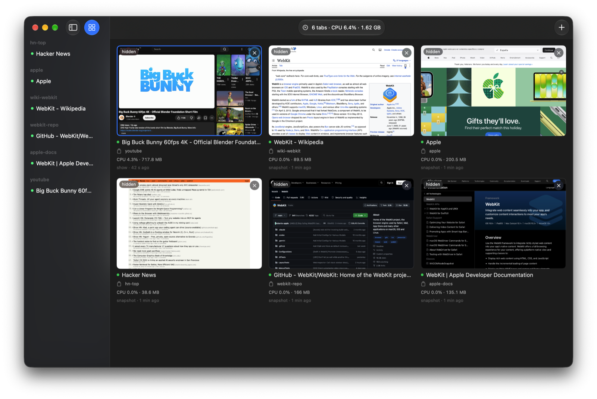

# agweb

A browser for coding agents on macOS, built on WebKit (Safari's engine). I run several coding agents at once, and Playwright's Chrome windows kept stealing my keyboard, while headless browsers got blocked by some sites and left me guessing what went wrong. agweb is one window that never takes focus: agents drive it from the shell with `agweb`, a playwright-cli-style command, and you watch them all live.



Idle tabs are suspended: on my Mac five open pages sit at 0% CPU, where Chrome's GPU process kept five to seven cores busy.

| Five idle pages   | Memory |
|-------------------|--------|
| agweb             | 590 MB |
| Headless Chrome   | 730 MB |
| Playwright Chrome | 1.6 GB |

- **Never steals focus.** No window comes to the front, nothing pops up. Dialogs, changing tabs, file pickers and downloads are answered in code.
- **You can always see it.** The dashboard (⌘D) shows every tab of every agent at once, live, with each agent's last command. And it is always a real window: some sites block headless browsers, and headless leaves you guessing what went wrong.
- **Many agents at once.** Each agent works in its own workspace with its own tabs, grouped by agent in the sidebar.
- **Log in once.** A named profile (`-p work`) keeps its logins and is shared by every agent using it, at the same time.
- **Light.** Idle tabs are throttled and then suspended, so open pages cost almost nothing once nobody uses them.
- **Acts like a person.** Clicks and keys are native macOS events, and the pointer moves like a hand, so hover menus and drag-and-drop work.
- **Made for agents.** Snapshots give each element a ref that lasts while it is on the page. `snapshot --diff` and `find` show only what matters, and every action reports what it changed.
- **Passwords stay out of the transcript.** `fill --secret-cmd 'pass show site'` types a secret the agent never sees in replies. 1Password and Bitwarden CLIs work too.
- **Demo videos.** `video-start` records a tab to MP4, with the pointer and clicks drawn in.


## Install

Needs macOS 26 or later. Download `Agweb.dmg` from [Releases](../../releases), drag Agweb to Applications and open it. Then Help ▸ Install Command Line Tool and Help ▸ Install Agent Skill (for Claude Code and Codex). Both are links into the app, so they update with it.

To build from source instead (Xcode 26 or later):

```sh
./scripts/build.sh
build/Agweb.app/Contents/Helpers/agweb install-cli
agweb install-skill
```

## Use

```sh
agweb -w task open en.wikipedia.org/wiki/WebKit   # a workspace for this task; starts the app if needed
agweb -w task snapshot                            # the page as a tree with [ref=eN] handles
agweb -w task click 'role=button[name="Main menu"]'
```

The click's reply already says what it did, so the agent needs no second snapshot:

```
### Changes
  - navigation "Site" [ref=e2]
-   - button "Main menu" [ref=e3]
+   - button "Main menu" [checked] [expanded] [ref=e3]
+   - list [ref=e1167]
+     - listitem [ref=e1168]
+       - link "Main page" [ref=e1169]
```

`agweb help` lists every command. Settings (⌘,) has text size, dashboard columns and a CPU and memory readout.

## Compared with playwright-cli

Same commands where possible, so agents already know them; a Playwright name it lacks suggests its own (`scroll-to` → `scroll-into-view`). On top:

- **Replies say what changed**: fetches started, lines added or removed, dialogs, popups, downloads, console errors. No snapshot after every step, so far fewer tokens.
- **Refs last** while the element is on the page.
- **`ask`** hands the tab to you for a login, MFA code or CAPTCHA, without taking focus.
- **Actions wait** for the fetches they caused, so agents rarely sleep.
- **`text`** returns the page's article as markdown.
- **Shared logins**: agents on one profile run at once; a Chrome profile opens in one browser only.

## Limits

- WebKit only: no Chrome DevTools Protocol, so Playwright and Chrome extensions can't attach, and Chrome-only sites may misbehave.
- `route` mocks fetch and XHR only; `requests` lists images, scripts and styles by URL only (`--static`).
- For what it can't do, use Playwright.

## Develop

`./scripts/selftest.sh` runs every command against a local page in a separate instance; `swift test` runs the unit tests. `AGWEB_ROOT=/tmp/dir` starts a second instance beside your own that keeps everything in that folder. [Defuddle](https://github.com/kepano/defuddle) (MIT) is bundled for `text`.
